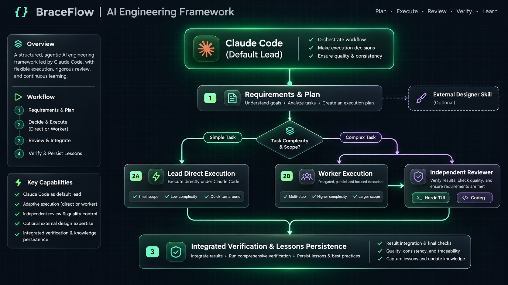

<div align="center">

# BraceFlow

**Brace your AI coding agent, ship with engineering discipline.**

Claude Code default Lead · Plan, implementation, review, and verification in one structured flow

[](https://code.claude.com)
[](https://github.com/Inmata/workflow/releases)
[](#requirements)
[](https://nodejs.org)
[](LICENSE)

[Quick start](#quick-start) · [Why BraceFlow](#why-braceflow) · [Optional capabilities](#optional-capabilities) · [Documentation](#documentation) · [简体中文](README.md)

</div>

---

> **AI writes code quickly. Delivering a project is slower.**
>
> Is the requirement clear? Was the approach compared? Who implements, and who reviews independently? Can the next session pick up where this one stopped?
>
> **BraceFlow** brings those answers into everyday Claude Code collaboration.

## Claude Code is the default

Claude Code receives the request, plans by default, saves preparation, decides whether to split the work, then coordinates implementation, review and finish.

External Designers, Herdr and Codeg are supported options. None is required, and none creates a second workflow.

<div align="center">
  
</div>

<details>
<summary>Click to view terminal box-drawing diagram</summary>

```text
┌─ Core Flow: Claude Code Full-Cycle ──────────────────────────┐
│                                                              │
│   Clarify ────► Approach ──► [Task Routing]                  │
│                                │                             │
│                ┌───────────────┴───────────────┐             │
│                ▼                               ▼             │
│        [Simple] Direct Lead             [Complex] Worker     │
│                │                               │             │
│                │                               ▼             │
│                │                      Independent Reviewer   │
│                │                               │             │
│                └───────────────┬───────────────┘             │
│                                ▼                             │
│                      Verification ──► Wrap-up                │
└────────────────────────────────┼─────────────────────────────┘
                                 │
     Optional Extensions         ▼
     ├─ Planning: External Designer (via workflow-designer Skill)
     └─ Execution: Herdr TUI / Codeg delegation channels
```

</details>

A host, a responsibility and a runtime entry are different things:

| Layer | Answers | In BraceFlow |
| --- | --- | --- |
| **Host** | Who receives the request and owns the Lead role | Claude Code |
| **Responsibility** | Who designs, implements, reviews and finishes | Designer · Lead · Worker · Reviewer |
| **Runtime entry** | Where execution agents are reached | Herdr TUI · Codeg (optional) |

## Why BraceFlow

| Clarify first | Work cleanly | Stay resumable |
| --- | --- | --- |
| Requirements and acceptance come before the approach. | Real code goes to a Worker; key changes get an independent Reviewer. | Plans, state, project facts and lessons can be restored. |
| Small tasks stay direct; only larger work enters full preparation. | A review that does not match the final delivery cannot pass. | A new session does not re-interview confirmed decisions. |
| The Lead never invents a default answer or treats plan approval as permission to start. | Every requirement has a check entry and final evidence. | Optional background review never blocks delivery. |

## A typical task

```text
You   Login times out after 30 seconds. Please find and fix it.

Lead  I will confirm the symptom and acceptance first. This is a real
      code fix, so I will prepare the work, assign a Worker, then send
      the final delivery to an independent Reviewer.

      ✓ Requirements and acceptance confirmed
      ✓ Plan and per-package choices saved
      → Waiting for your approval to start

You   Start.

Lead  The Worker fixed the implementation and ran its tests.
      The Reviewer returned PASS for the final delivery.
      Integration passed: login completes within five seconds,
      and all existing tests pass.

      Changed: src/session.ts, test/session.test.ts
      Verified: npm test · login-timeout regression
      Remaining: none
```

This is a typical flow, not a fixed script. The Lead handles simple tasks directly and never invents a Worker or Reviewer for a read-only check.

## Quick start

Requires Windows and Node.js 24+. Run from the repository root:

```powershell
node bin/workflow.mjs install --agent claude
node bin/workflow.mjs doctor --agent claude
node bin/workflow.mjs project onboard --root "D:/your-project"
```

Then open a new Claude Code session in that project and describe what you need.

The first session checks the project's documents, conventions and acceptance commands. After that, no manual signals are needed: the Lead saves necessary preparation, records assignments and reviews, and finishes with what changed, how it was verified and what remains.

Installation and onboarding never commit, push or publish automatically.

[Full installation, upgrades and troubleshooting](docs/usage.md) · [Preparation and cross-session resume](docs/references/preparation.md)

## Optional capabilities

### Let another model plan

Let an external agent such as Codex, Pi or OpenCode load `workflow-designer`. It handles requirement clarification, technical approach and implementation arrangements, writes one Markdown plan, then hands it back to Claude Code for review and continuation.

```powershell
node skills/workflow-designer/link.mjs
```

This links to `~/.agents/skills/workflow-designer`. Existing content causes a conflict report, never an overwrite. Claude Code does not need this Skill.

[Designer contract and linking guide](docs/designer.md)

### Collaborate from another terminal

Herdr TUI and Codeg are optional runtime entries for execution agents. They do not change plans, work packages or acceptance rules. Herdr GUI and Cindy still need real-host adaptation and are not yet available.

## Current support

| Product | Role in workflow | Status |
| --- | --- | --- |
| **Claude Code** | Default host and Lead | **Supported** |
| **Herdr TUI** | Delegation entry for execution agents | **Verified on a real host** |
| **Codeg** | Optional delegation and management entry | **Optional adapter** |
| **Herdr GUI** | Delegation entry for execution agents | **Real-host adaptation pending** |
| **Cindy** | Desktop entry for execution agents | **Real-host adaptation pending** |
| **Codex** | Optional external Designer only | **Execution adapter retained, not currently supported** |

Codex hooks, plugin files and adapter code remain for future adaptation. They are not installation, Lead or execution entries in the current product.

[Claude Code](docs/adapters/claude.md) · [Herdr](docs/adapters/herdr.md) · [Codeg](docs/adapters/codeg.md) · [Cindy](docs/adapters/cindy.md)

## Documentation

| Topic | Start here |
| --- | --- |
| Task routing, review and acceptance | [Common method](docs/workflow.md) · [Lead guide](docs/roles/lead.md) |
| Installation, upgrades, removal and commands | [Usage](docs/usage.md) |
| Project lessons and optional background review | [Learning](docs/learning.md) · [Background review](docs/background-review.md) |
| Signals, state and specs | [Protocol](docs/design/protocol.md) · [Plans and specs](docs/references/spec-plan.md) |
| Walk through the examples | [Parallel changes](examples/parallel-change/README.md) · [Dependencies and repair](examples/dependency-and-repair/README.md) · [Preparation and resume](examples/preparation-and-resume/README.md) |
| Verification boundaries of this version | [Acceptance](docs/acceptance.md) |
| Repository maintenance and release history | [Development guide](https://github.com/Inmata/workflow/blob/main/docs/README.md) · [Release history](docs/releases.md) |

## Requirements

Windows 10+, Node.js 24+, ESM, no third-party runtime dependencies and no resident service.

workflow manages project development lessons; the independent [document-learning](https://github.com/Inmata/document-learning) project manages personal document-writing lessons.

<div align="center">

<sub>Current source version 0.10.1 · MIT License</sub>

</div>
