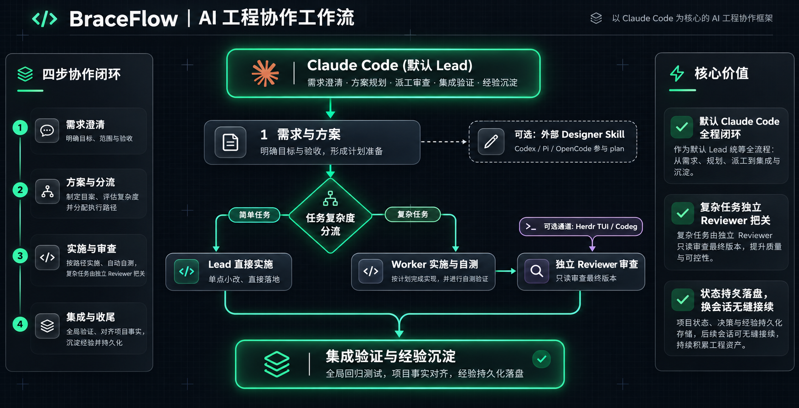

<div align="center">

# BraceFlow

**为 AI 注入工程骨架，让交付稳健发生。**

Claude Code 默认 Lead · 计划、实施、审查、验收全链路工程化

[](https://code.claude.com)
[](https://github.com/Inmata/workflow/releases)
[](#运行环境)
[](https://nodejs.org)
[](LICENSE)

[快速开始](#快速开始) · [为什么用](#为什么用-braceflow) · [可选能力](#可选能力) · [文档](#文档地图) · [English](README.en.md)

</div>

---

> **AI 写代码很快，项目交付不是。**
>
> 需求说清楚了吗？方案比较过吗？谁实施、谁独立审查？下次打开会话，还接得上吗？
>
> **BraceFlow** 把这四件事放进 Claude Code 的日常协作。

## 默认只需要 Claude Code

Claude Code 接收需求、自己完成 plan、保存准备、决定是否分工，再协调实施、审查与收尾。

外部 Designer、Herdr、Codeg 都可以用，但都不是安装前提，也不是另一套工作流。

<div align="center">
  
</div>

<details>
<summary>点击查看终端纯文本工程框图</summary>

```text
┌─ 核心主线：Claude Code 全程闭环 ──────────────────────────────┐
│                                                               │
│   需求澄清 ──► 技术方案 ──► [分流决策]                        │
│                                │                              │
│                ┌───────────────┴───────────────┐              │
│                ▼                               ▼              │
│         [简单] Lead 直做               [复杂] 派发 Worker     │
│                │                               │              │
│                │                               ▼              │
│                │                        独立 Reviewer         │
│                │                               │              │
│                └───────────────┬───────────────┘              │
│                                ▼                              │
│                        集成验证 ──► 收尾沉淀                  │
└────────────────────────────────┼──────────────────────────────┘
                                 │
     可选扩展 (按需接入)         ▼
     ├─ 方案设计: 外部 Designer (通过 workflow-designer Skill)
     └─ 终端执行: Herdr TUI / Codeg 委派通道
```

</details>

宿主、职责和运行入口是三件不同的事：

| 层 | 回答的问题 | BraceFlow 中的位置 |
| --- | --- | --- |
| **宿主** | 谁接收需求、承担 Lead | Claude Code |
| **职责** | 谁设计、实施、审查、收尾 | Designer · Lead · Worker · Reviewer |
| **运行入口** | 从哪里联系执行 Agent | Herdr TUI · Codeg（可选） |

## 为什么用 BraceFlow

| 想清楚 | 做干净 | 接得上 |
| --- | --- | --- |
| 先问清需求和验收，再比较方案。 | 真实代码交给 Worker，关键改动有独立 Reviewer。 | 计划、状态、项目事实和经验都能恢复。 |
| 小任务直接做，大任务才进入完整准备。 | 审查对不上最终版本，就不能算通过。 | 换会话不必重新访谈已经确认的决定。 |
| 不替用户猜默认值，也不把方案确认当开工。 | 每条需求有检查入口，收尾有最终证据。 | 后台复盘可选，不阻塞日常交付。 |

## 一次真实回合

```text
你    登录 30 秒后超时，帮我查一下并修掉。

Lead  先确认现象和验收。这是真实代码修复，我会查项目现有实现，
      准备完成后派 Worker 修改，再让独立 Reviewer 审查最终版本。

      ✓ 需求与验收已确认
      ✓ 计划与逐包选择已保存
      → 等待你确认开工

你    开工。

Lead  Worker 已修复实现并自测。
      Reviewer 对最终交付给出 PASS。
      集成验证通过：登录在 5 秒内完成，原有用例全部通过。

      改动：src/session.ts, test/session.test.ts
      验证：npm test · 登录超时回归
      剩余：无
```

这是典型流程，不是固定脚本。简单任务由 Lead 直接完成；只做只读检查时，不会虚构 Worker 或 Reviewer。

## 快速开始

需要 Windows 与 Node.js 24+。在仓库根目录执行：

```powershell
node bin/workflow.mjs install --agent claude
node bin/workflow.mjs doctor --agent claude
node bin/workflow.mjs project onboard --root "D:/你的项目"
```

然后在项目里打开一个新的 Claude Code 会话，直接说出需求。

首次会话会核对项目资料、约定与验收入口。以后不需要手发信号：Lead 会保存必要的准备、记录分工和审查，并在结束时说明改了什么、如何验证、还剩什么。

安装和接入都不会自动提交、推送或发布。

[完整安装、升级与排错](docs/usage.md) · [准备和跨会话接续](docs/references/preparation.md)

## 可选能力

### 让其他模型先做 plan

让 Codex、Pi、OpenCode 等外部 Agent 加载 `workflow-designer`。它只负责需求澄清、技术方案和实施安排，写出一份计划 Markdown，再交回 Claude Code 核对与接续。

```powershell
node skills/workflow-designer/link.mjs
```

默认链接到 `~/.agents/skills/workflow-designer`。已有其他内容时只报告冲突，不覆盖。Claude Code 不需要这个 Skill。

[Designer 接口与链接说明](docs/designer.md)

### 在其他终端里协作

Herdr TUI 和 Codeg 是执行 Agent 的可选运行入口，不改变计划、工作包和验收规则。Herdr GUI 与 Cindy 仍待真机适配，不能视为可用。

## 当前支持范围

| 对象 | 在产品中的位置 | 状态 |
| --- | --- | --- |
| **Claude Code** | 默认宿主与 Lead | **已适配** |
| **Herdr TUI** | 执行 Agent 的委派入口 | **已真机验证** |
| **Codeg** | 可选委派与管理入口 | **可选适配** |
| **Herdr GUI** | 执行 Agent 的委派入口 | **待真机适配** |
| **Cindy** | 执行 Agent 的桌面入口 | **待真机适配** |
| **Codex** | 仅作为可选外部 Designer | **执行端适配保留，当前不支持** |

Codex 的 hooks、插件和适配代码继续保留，方便以后恢复适配。它们不属于当前产品的安装、Lead 或执行端入口。

[Claude Code](docs/adapters/claude.md) · [Herdr](docs/adapters/herdr.md) · [Codeg](docs/adapters/codeg.md) · [Cindy](docs/adapters/cindy.md)

## 文档地图

| 想深入了解 | 从这里开始 |
| --- | --- |
| 任务怎么分流、审查和验收 | [公共方法](docs/workflow.md) · [Lead 指引](docs/roles/lead.md) |
| 安装、升级、卸载和全部命令 | [使用说明](docs/usage.md) |
| 项目经验与可选后台复盘 | [经验学习](docs/learning.md) · [后台复盘](docs/background-review.md) |
| 信号、状态机与 spec | [协议](docs/design/protocol.md) · [计划和 spec](docs/references/spec-plan.md) |
| 跟着案例走一遍 | [并行改动](examples/parallel-change/README.md) · [依赖返修](examples/dependency-and-repair/README.md) · [准备接续](examples/preparation-and-resume/README.md) |
| 当前版本的验证边界 | [验收说明](docs/acceptance.md) |
| 维护本仓与查看版本沿革 | [开发文档](https://github.com/Inmata/workflow/blob/main/docs/README.md) · [版本记录](docs/releases.md) |

## 运行环境

Windows 10+，Node.js 24+，ESM，无第三方运行时依赖，无常驻服务。

项目开发经验由 workflow 管理；个人文档经验由独立的 [document-learning](https://github.com/Inmata/document-learning) 管理。

<div align="center">

<sub>当前源码版本 0.10.1 · MIT License</sub>

</div>
